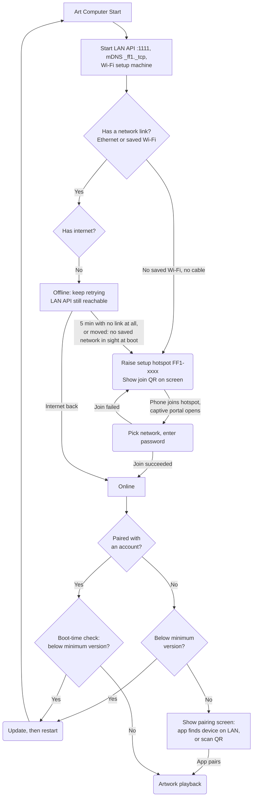
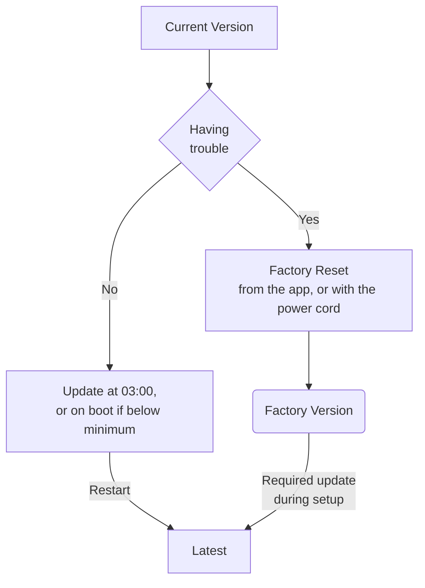
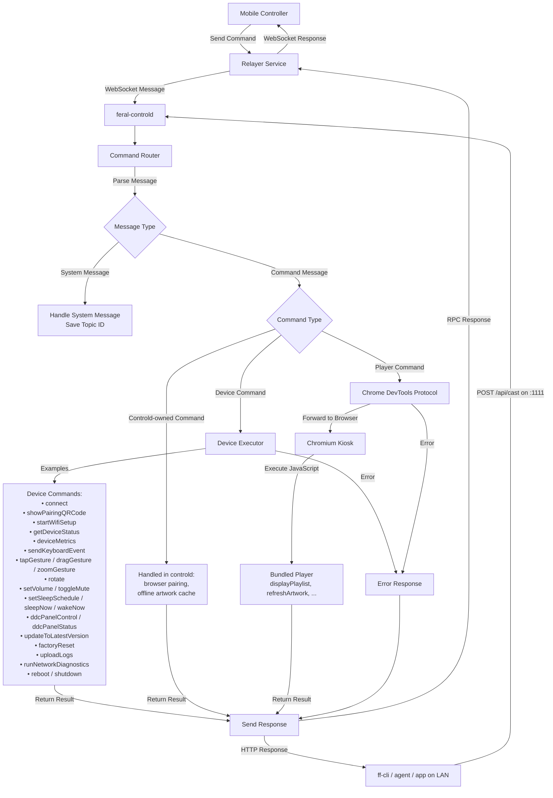

# Art Computer life cycle

All of the behaviour on this page lives in `feral-controld`, the Go device daemon in [`ffos-user`](https://github.com/feral-file/ffos-user). It owns connectivity, command routing, and the whole setup domain: the Wi-Fi setup hotspot and captive portal, the OTA gate, the on-screen setup narration, pairing, factory reset, and the LAN API. There is no separate setup daemon and no Bluetooth path.

## Setup and startup

### Boot to playback

Key points:

- **The LAN API and mDNS come up first**, before the cloud relayer or the Chromium connection. A relayer outage can never block setup, and the device stays controllable on the local network even with no internet.
- **Wi-Fi setup is a hotspot plus a captive portal.** A device with no saved Wi-Fi and no cable raises its own hotspot `FF1-<device id>` (WPA2, 8-digit numeric password shown on screen with a QR code). The phone joins it, the OS pops the captive portal (or the user opens the direct numeric address shown on the TV), and the user picks a network. The hotspot goes down while the device joins, and comes back up if the join fails so the user can retry.
- **Ethernet skips Wi-Fi setup.** A device with a cable and internet goes straight to the pairing screen.
- **Pairing is gated on version.** An unclaimed device must be at or above the branch's minimum version before the pairing screen appears — see [OTA](./ota.md).
- **The pairing screen offers two paths.** The primary path is the app discovering the device over the local network (mDNS `_ff1._tcp`); the QR code (`https://link.feralfile.com/device_connect/...`) is the backup for when discovery is blocked. Either way the phone binds the device to the account through the cloud.
- **An already-paired device that loses its network does not show setup over its artwork.** It keeps retrying quietly; only after five minutes with no link at all (no cable, no Wi-Fi association — a changed Wi-Fi password or a vanished network) does it raise the hotspot again. One case is faster: a device that **boots** with no link and cannot see any of its saved networks — the signature of a frame that has been moved — is recognised within about a minute and raises the hotspot straight away. A device whose Wi-Fi is associated but has no upstream (ISP outage, air-gapped gallery) stays put: it keeps its LAN API and mDNS. To move a paired device to a new Wi-Fi while the old one is still in range, the app puts it back into setup mode on demand (`startWifiSetup`, over the LAN or the relayer).
- **An unpaired device is never left stranded.** If a device is online but nobody pairs it, it periodically re-opens the setup hotspot on its own (the *setup-incomplete* cycle) so the Wi-Fi step can be redone without the app.

### App update

There is no "previous version" to roll back to: once an update's single trial boot succeeds, the previous system is discarded. A candidate whose kernel fails to boot falls back to the previous system on the next power cycle automatically. For everything else the recovery path is a [factory reset](../factory-reset.md), after which the device updates itself back to the current version during setup. See [OTA](./ota.md).

### Command Processing Flow

Both transports — the cloud relayer and the LAN API on port 1111 — accept the same JSON envelope (`{"command": ..., "request": {...}}`) and go through the same router. Commands the device itself owns (pairing, power, network, panel control, updates) run in the device executor; everything about what is on screen (`displayPlaylist`, `refreshArtwork`, …) is forwarded to the bundled player in the Chromium kiosk over the Chrome DevTools Protocol. The router also protects the device from command storms: high-cost commands are rate-limited and bounded by a global concurrency budget, and a rejected command comes back as `rate_limited` over the relayer, or as HTTP `429` on the LAN API.

The device also pushes notifications the other way — `player_status` (what is playing and whether it rendered) and `device_status` (rotation, Wi-Fi name, installed and latest version, volume, sleep schedule, …) — over the relayer and, for local clients, over a WebSocket at `/api/notification` on port 1111.

## Telemetry

Telemetry is a pull-then-push pipeline, not a heartbeat message:

1. `feral-sys-monitord` samples the device every few seconds and publishes system metrics on the local D-Bus session bus (for `feral-controld` and `feral-watchdog`) and as Prometheus metrics on `localhost:9001`.
2. `feral-controld` exposes playback and network metrics on the LAN API at `:1111/metrics`.
3. A local `vmagent` scrapes both endpoints once a minute and remote-writes them to `https://ingest-metrics.feralfile.com`, labelled with the device id, FF OS version, branch, and CPU / memory model. `feral-watchdog` adds a `ff_crash_reboot{reason=...}` event when it has to reboot the device.

Telemetry is only sent while the device has network connectivity; vmagent queues locally (bounded) while offline. Turning **analytics off** in the app stops the scraping entirely — only explicit events such as crash reboots and OTA results are still pushed.

### What is collected

| Field | Description |
| :--- | :--- |
| `cpu` | Current / max frequency and temperature |
| `gpu` | Current / max frequency and temperature, and driver-reported busy percentage |
| `memory` | Used and total capacity |
| `disk` | Used, available, and total capacity |
| `screen` | Width, height, and refresh rate of the attached display |
| `uptime` | Seconds since the last boot |
| `timestamp` | When the sample was taken |
| Playback and network | Render outcomes, link state, Wi-Fi signal, relayer connection state and disconnect count (from `feral-controld`) |

The same metrics drive the device's own recovery: `feral-watchdog` watches the Chromium kiosk over the DevTools Protocol and restarts it on a hang (rebooting after repeated restarts), cleans the package cache when the disk fills, restarts the kiosk on sustained RAM pressure, and reboots on a GPU hang.

### Setup screen states

Setup progress is pushed from `feral-controld` to the bundled player as a set of named states. The ones you will see on the screen:

| State | Shown when |
| :- | :- |
| `scanning` | Looking for nearby Wi-Fi networks before the setup hotspot comes up. |
| `softap_qr` | The setup hotspot is up; join `FF1-<device id>` (QR code and password on screen). |
| `joining` | Credentials submitted; the device is joining your network. |
| `join_failed` | The join failed (wrong password, network not found, timeout); the hotspot is back up for a retry. |
| `finalizing` | Joined; checking for a required update before pairing (this is what you see while a slow version check retries). |
| `connecting` | A paired device is offline and looking for its network, or connected with no internet. |
| `updating` | An OTA update is installing (progress shown). |
| `claim_qr` | Online and up to date; showing the pairing screen. |
| `ready` | Pairing confirmed; the player owns the screen. |
| `setup_error` | The setup hotspot could not be raised or released after repeated attempts; the device keeps retrying underneath. |
| `factory_reset` | A factory reset has been staged; the device is about to restart. |
| `hidden` | Overlay hidden; normal artwork playback. |

The live setup state is also readable on the LAN API as `setup_state` on `GET /api/status` (`starting`, `online`, `offline_retrying`, `unprovisioned`, `ap_active`, `joining`).

## Version control

FF OS images are deployed on two branches:

- `develop` — internal development builds
- `release` — production builds, served from https://ffos.feralfile.com

Versioning follows the Semantic Versioning format.

Each branch's version manifest specifies a `min_runtime_version` and a `latest_version` (and optionally a `min_upgradeable_version`, below which a device must be reflashed from USB). If the version on the device is older than `min_runtime_version`, the device is forced to update — at boot, and before it will show the pairing screen. Otherwise it updates to the latest version silently at 03:00.
